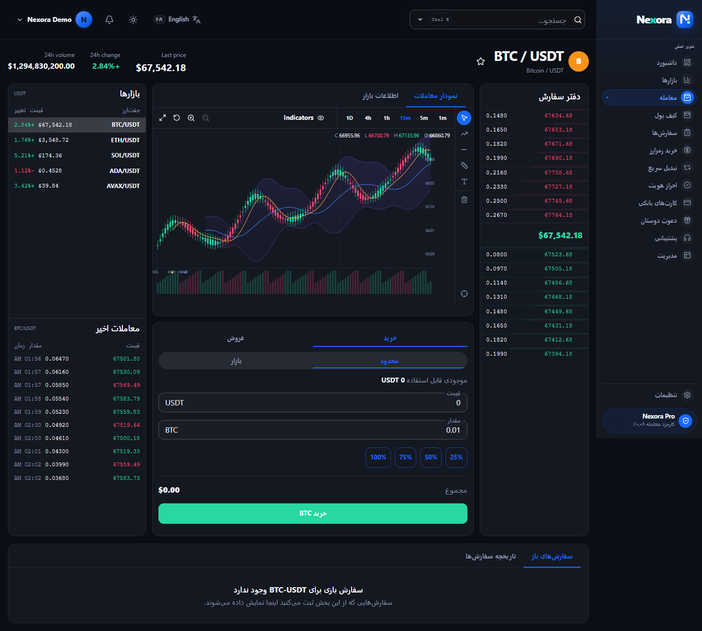
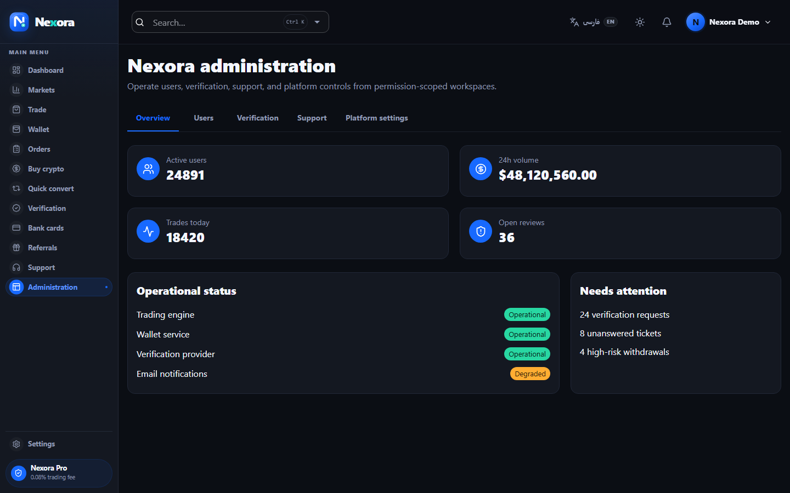
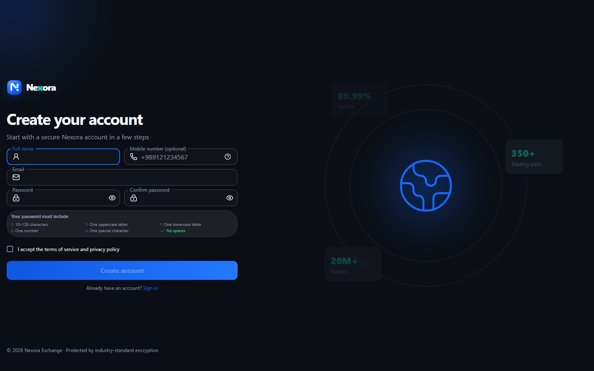
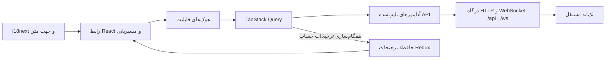

<!-- source: README.md; source-sha256: 44c87afefc21be2854def952b7414b0ddb398691a0e3c21304fb5aee71a22069 -->

# نکسورا

[English](README.md) | [فارسی](README.fa.md)

نکسورا یک رابط کاربری دو‌زبانه برای صرافی دارایی‌های دیجیتال است که با React و TypeScript ساخته شده است. این پروژه معماری فرانت‌اندی نزدیک به نیازهای محیط واقعی را برای پایش سبد دارایی، مشاهدهٔ بازار، معامله، کیف پول، احراز هویت، پشتیبانی و مدیریت مبتنی بر مجوز نمایش می‌دهد.

این مخزن فقط وب‌کلاینت و آزمون‌های خودکار آن را در بر می‌گیرد. بک‌اند در مخزن مستقل [`HmdAK19/nexora-api`](https://github.com/HmdAK19/nexora-api) نگهداری می‌شود. اجرای مالی، نگه‌داری دارایی، بررسی هویت و وضعیت پایدار حساب در این مخزن به‌عنوان قابلیت آمادهٔ تولید معرفی نمی‌شوند.

## پیش‌نمایش محصول

| داشبورد سبد دارایی                           | محیط معامله                                     |
| -------------------------------------------- | ----------------------------------------------- |
|  |  |

| نمای مدیریت                                           | ثبت‌نام حساب                                      |
| ----------------------------------------------------- | ------------------------------------------------- |
|  |  |

<details>
<summary>مشاهدهٔ صفحهٔ ورود</summary>


</details>

## ویژگی‌های مهندسی

- ماژول‌های مبتنی بر قابلیت با مرزهای روشن `api`، `components`، `hooks`، `lib`، `model`، `locales` و `pages`
- TypeScript سخت‌گیرانه، اعتبارسنجی زمان اجرا در مرزهای حساس API و فرم‌های مبتنی بر schema
- TanStack Query برای وضعیت راه‌دور، invalidation محدود cache و ابزارهای به‌روزرسانی خوش‌بینانه
- access token کوتاه‌عمر در حافظه، بازیابی نشست و جلوگیری از refresh هم‌زمان تکراری
- مسیریابی و ناوبری مبتنی بر مجوز با رویکرد deny-by-default؛ API همچنان مرز امنیتی نهایی است
- محیط معاملهٔ واکنش‌گرا با دادهٔ زنده، دفتر سفارش، معاملات اخیر، نمودار و ثبت سفارش
- هماهنگی کامل فارسی/انگلیسی و RTL/LTR
- پروفایل، اعلان‌ها، تنظیمات امنیتی، TOTP، نشست‌ها و ترجیحات متصل به سرور
- حالت‌های دسترس‌پذیر بارگذاری، خالی، خطا، تلاش مجدد، اعتبارسنجی و تأیید
- code splitting در سطح route، فهرست‌های مجازی و پوستهٔ PWA قابل نصب
- زیرساخت آزمون واحد، component، مرز API، دسترس‌پذیری و E2E در چند اندازهٔ صفحه

## محدودهٔ برنامه

| بخش               | پیاده‌سازی فرانت‌اند                                       | نیاز محیط واقعی                                                      |
| ----------------- | ---------------------------------------------------------- | -------------------------------------------------------------------- |
| احراز هویت        | ورود، بازیابی نشست، خروج و درخواست بازیابی رمز             | ارائه‌دهندهٔ هویت، ذخیرهٔ امن نشست، ارسال بازیابی و کنترل سوءاستفاده |
| بازار و معامله    | فهرست بازار، دادهٔ زنده، نمودار، عمق، ثبت و تاریخچهٔ سفارش | دادهٔ دارای مجوز، نقدشوندگی/تطبیق و پردازش پایدار سفارش              |
| کیف پول و تبدیل   | موجودی، انتقال، تأیید نرخ و درخواست idempotent             | دفترکل دوطرفه، نگه‌داری دارایی، موتور ریسک و تسویه                   |
| احراز هویت و کارت | فرم‌های معتبر، گردش‌کار مدرک/کارت و نمایش ماسک‌شده         | ارائه‌دهندهٔ KYC، ذخیرهٔ رمز‌شده و tokenization پرداخت               |
| تنظیمات حساب      | پروفایل، تصویر، ترجیحات، رمز، نشست و TOTP                  | ذخیرهٔ خصوصی پایدار، تغییر ایمیل تأییدشده و کنترل‌های step-up        |
| مدیریت            | فضاهای مبتنی بر مجوز برای کاربر، احراز، پشتیبانی و تنظیمات | اعمال policy در سرور، audit پایدار و step-up authentication          |

وضعیت دقیق هر route در [فهرست قابلیت‌ها](docs/FEATURES.fa.md) نگهداری می‌شود.

## معماری



فرانت‌اند بر اساس قابلیت‌های کسب‌وکار سازمان‌دهی شده است. صفحه‌ها هوک‌ها و اجزای نمایشی را ترکیب می‌کنند، درخواست‌های شبکه در آداپتورهای API قرار دارند و اعتبارسنجی و محاسبات در توابع خالص و قابل استفادهٔ مجدد باقی می‌مانند. جزئیات در [معماری](docs/ARCHITECTURE.fa.md) آمده است.

## فناوری‌ها

- React 19، TypeScript و Vite
- Material UI و Emotion
- TanStack Query، Redux Toolkit و Redux Persist
- React Hook Form و Yup
- Axios و WebSocket
- i18next با منابع فارسی و انگلیسی
- Vitest، Testing Library، MSW، `vitest-axe` و Playwright
- Vite PWA

## توسعهٔ محلی

### پیش‌نیازها

- Node.js 20 یا جدیدتر
- npm
- [Nexora API](https://github.com/HmdAK19/nexora-api) مطابق [قرارداد API](docs/API.fa.md)

### نصب و اجرا

```bash
npm ci
npm run dev
```

فرانت‌اند در `http://localhost:5173` اجرا می‌شود. Vite در محیط توسعه مسیرهای `/api` و `/ws` را به `http://localhost:4000` proxy می‌کند. بدون بک‌اند سازگار، پوستهٔ عمومی بارگذاری می‌شود اما گردش‌کارهای دادهٔ احراز‌شده حالت خطا را نمایش می‌دهند.

### پیکربندی زمان اجرا

خروجی تولید پیش از آغاز React فایل [`public/runtime-config.json`](public/runtime-config.json) را می‌خواند:

```json
{
  "apiBaseUrl": "/api",
  "webSocketUrl": "/ws"
}
```

پس از `npm run build` می‌توان `dist/runtime-config.json` را بدون build مجدد برای بک‌اند دیگری تنظیم کرد. هرگز secret را در این فایل عمومی قرار ندهید. حساب‌های نمایشی عمومی صرفاً برای نمایش نمونه‌کار هستند و باید در محیط واقعی حذف یا جایگزین شوند.

## کنترل‌های کیفیت

```bash
npm run docs:check
npm run format:check
npm run typecheck
npm run lint
npm test
npm run test:coverage
npm run build
npm run test:e2e
```

## وضعیت استقرار

فرانت‌اند به‌صورت یک SPA ایستای Vite روی Vercel قابل استقرار است. فایل [`vercel.json`](vercel.json) fallback مسیرهای کلاینت را فراهم می‌کند، `/api` و `/ws` را برای بک‌اند نگه می‌دارد و از cache شدن پیکربندی عمومی زمان اجرا جلوگیری می‌کند. الزامات CSP، cookie، proxy وب‌سوکت، مشاهده‌پذیری و rollback در [عملیات](docs/OPERATIONS.fa.md) مستند شده‌اند.

## محدوده و محدودیت‌ها

نکسورا یک پروژهٔ مهندسی فرانت‌اند است، نه صرافی دارای مجوز یا سامانهٔ نگه‌داری دارایی. این مخزن شامل دفترکل دوطرفهٔ پایدار، زیرساخت custody و امضا، تسویهٔ پرداخت، موتور تطبیق، یکپارچگی واقعی KYC/AML یا عملیات audit و incident در سطح تولید نیست. جزئیات در [مدل امنیتی](docs/SECURITY.fa.md) آمده است.

## مستندات

- [مخزن بک‌اند](https://github.com/HmdAK19/nexora-api)
- [نمایهٔ مستندات](docs/README.fa.md)
- [فهرست قابلیت‌ها](docs/FEATURES.fa.md)
- [معماری](docs/ARCHITECTURE.fa.md)
- [قرارداد API](docs/API.fa.md)
- [سیستم طراحی](docs/DESIGN_SYSTEM.fa.md)
- [امنیت](docs/SECURITY.fa.md)
- [راهبرد آزمون](docs/TESTING.fa.md)
- [راهنمای توسعه](docs/DEVELOPMENT.fa.md)
- [پیکربندی و عملیات](docs/OPERATIONS.fa.md)

## سیاست مستندات

مستندات بخشی از تعریف اتمام کار هستند. هر تغییر در رفتار، route، قرارداد API، معماری، پیکربندی، فرض‌های امنیتی، پوشش آزمون یا وضعیت قابلیت باید در همان تغییر در هر دو زبان به‌روزرسانی شود. دستور `npm run docs:check` همگامی ساختاری و revision ترجمه‌ها را کنترل می‌کند.
