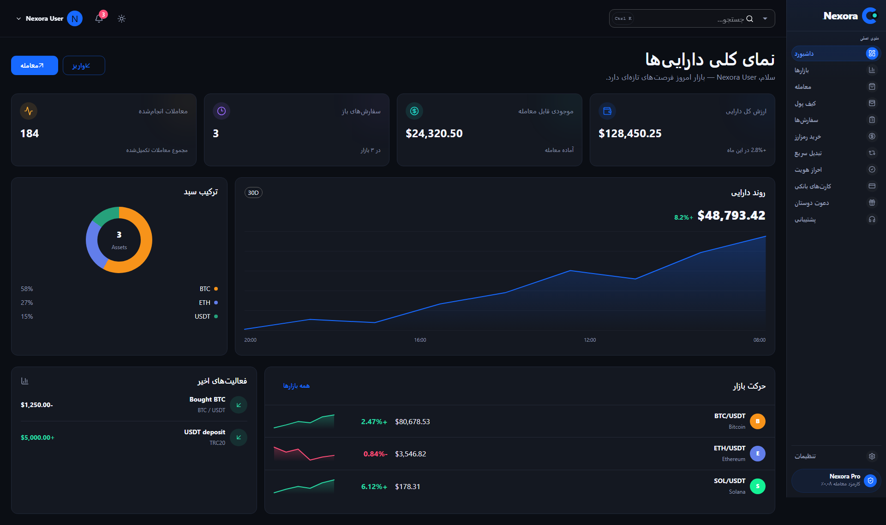
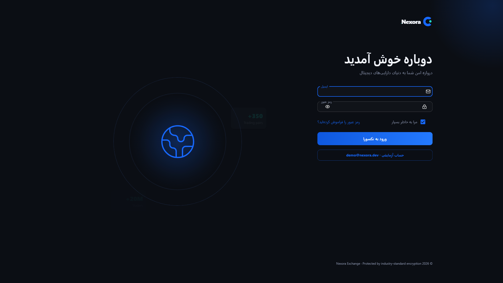

# Nexora

Nexora is a bilingual digital-asset exchange frontend built with React and TypeScript. It demonstrates a production-oriented frontend architecture for portfolio monitoring, market discovery, trading, wallet workflows, identity verification, customer support and permission-scoped administration.

The repository contains the web client and its automated tests. Financial execution, custody, identity review and durable account state belong to a separately deployed backend and are deliberately not represented as production-ready capabilities here.

## Product preview



<details>
<summary>Authentication screen</summary>



</details>

## Engineering highlights

- Feature-oriented modules with explicit `api`, `components`, `hooks`, `lib`, `model`, `locales` and `pages` boundaries
- Strict TypeScript, runtime validation at sensitive API boundaries and schema-driven form validation
- TanStack Query for remote state, narrow cache invalidation and reusable optimistic-update helpers
- Short-lived in-memory access tokens with refresh-session restoration and concurrent refresh deduplication
- Deny-by-default, permission-based route and navigation presentation; the API remains the authoritative security boundary
- Responsive trading workspace with live-market transport abstractions, order book, recent trades, chart tools and order entry
- English and Persian localization with synchronized LTR/RTL layout
- Accessible loading, empty, error, retry, validation and confirmation states
- Route-level code splitting, virtualized market lists and an installable PWA shell
- Unit, component, API-boundary, accessibility and multi-viewport E2E test infrastructure

## Application surface

| Area                   | Implemented in the frontend                                                         | Required for a real exchange                                                      |
| ---------------------- | ----------------------------------------------------------------------------------- | --------------------------------------------------------------------------------- |
| Authentication         | Login, refresh restoration, logout and password-reset request                       | Identity provider, secure session store, recovery delivery and abuse controls     |
| Markets and trading    | Market directory, streaming transport, charts, depth, order entry and order history | Licensed market data, matching/liquidity integration and durable order processing |
| Wallet and conversion  | Balance views, transfer forms, quote confirmation and idempotent request handling   | Double-entry ledger, custody, risk engine and settlement                          |
| Verification and cards | Validated forms, document/card workflows and masked display contracts               | KYC provider, encrypted object storage and payment-provider tokenization          |
| Administration         | Permission-scoped workspaces for users, verification, support and settings          | Server-side policy enforcement, durable audit trail and step-up authentication    |

The detailed implementation status for every route is maintained in [Feature catalogue](docs/FEATURES.md).

## Architecture

```mermaid
flowchart LR
  UI[React UI and routing] --> Hooks[Feature hooks]
  Hooks --> Query[TanStack Query]
  Query --> API[Typed API adapters]
  API --> Gateway[/api and /ws]
  Store[Redux persisted preferences] --> UI
  I18n[i18next and direction] --> UI
  Gateway --> Backend[Separately deployed backend]
```

The frontend is organized around business capabilities rather than technical page types. Pages compose feature hooks and view components; network calls live in API adapters; validation and calculations remain reusable pure modules. Shared code is restricted to stable cross-feature infrastructure and primitives.

See [Architecture](docs/ARCHITECTURE.md) for dependency rules, state ownership, authentication flow and cache-mutation policy.

## Technology

- React 19, TypeScript and Vite
- Material UI and Emotion
- TanStack Query, Redux Toolkit and Redux Persist
- React Hook Form and Yup
- Axios and WebSocket transport
- i18next with Persian/English resources
- Vitest, Testing Library, MSW, `vitest-axe` and Playwright
- Vite PWA

## Local development

### Requirements

- Node.js 20 or newer
- npm
- A backend implementing the contract in [API contract](docs/API.md) for authenticated and frontend-integrated flows

### Install and run

```bash
npm ci
npm run dev
```

The frontend is served at `http://localhost:5173`. During development, Vite proxies `/api` and `/ws` to `http://localhost:4000`. Without a compatible backend, the public shell can load but authenticated data workflows will display their error states.

## Quality gates

```bash
npm run format:check
npm run typecheck
npm run lint
npm test
npm run test:coverage
npm run build
npm run test:e2e
```

| Command                 | Purpose                                               |
| ----------------------- | ----------------------------------------------------- |
| `npm run dev`           | Start the Vite development server                     |
| `npm run build`         | Type-check and generate the production bundle         |
| `npm run preview`       | Serve the generated bundle locally                    |
| `npm run typecheck`     | Run strict TypeScript checks                          |
| `npm run lint`          | Run ESLint with zero warnings allowed                 |
| `npm test`              | Run the unit and component suite once                 |
| `npm run test:coverage` | Enforce coverage thresholds on critical modules       |
| `npm run test:e2e`      | Run Playwright smoke tests at multiple viewport sizes |
| `npm run format:check`  | Verify Prettier formatting                            |

## Deployment status

A public deployment is not currently maintained from this repository. The production build is a static SPA and can be deployed to a CDN or static host when a compatible backend and same-origin `/api` and `/ws` gateway are available. Deployment, CSP, cookies, WebSocket proxying and observability requirements are documented in [Operations](docs/OPERATIONS.md).

## Scope and limitations

Nexora is a frontend engineering project, not a licensed exchange or a custody system. The repository does not include:

- a durable double-entry ledger;
- custody or signing infrastructure;
- payment settlement;
- a matching engine or external liquidity execution;
- production KYC/AML and sanctions integrations;
- production-grade audit storage, monitoring or incident operations.

These boundaries are intentional and documented so that UI completeness is not confused with financial-system readiness. See [Security](docs/SECURITY.md) for the trust model and production checklist.

## Documentation

- [Documentation index](docs/README.md)
- [Feature catalogue and route status](docs/FEATURES.md)
- [Architecture and module boundaries](docs/ARCHITECTURE.md)
- [HTTP and WebSocket API contract](docs/API.md)
- [Design system, responsiveness and accessibility](docs/DESIGN_SYSTEM.md)
- [Security model and production checklist](docs/SECURITY.md)
- [Testing strategy and coverage](docs/TESTING.md)
- [Development and contribution guide](docs/DEVELOPMENT.md)
- [Configuration, deployment and operations](docs/OPERATIONS.md)

## Documentation policy

Documentation is part of the definition of done. Changes to behavior, routes, API contracts, architecture, configuration, security assumptions, test coverage or feature status must update the relevant document in the same change.
